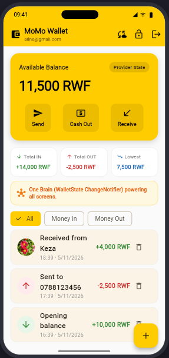
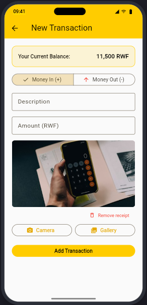

# MoMo Wallet

Track the money you send and receive, with a photo of every receipt, on any phone you log in from.

## Download

| Direct Download Link | Scan to Download on Phone |
|:---:|:---:|
| [📱 **Download Latest APK**](https://github.com/nshh123/momo-wallet/releases/latest) *(for Android phones)* |  |

## Features
- Create an account and log in with secure Firebase Authentication
- Add, edit, and delete transactions with receipt photos
- Live real-time balance calculations across devices
- Quick filter chips: All, Money In (+), Money Out (-)
- Private per-user Cloud Firestore storage enforced by server-side security rules

## Screenshots
| Login | Wallet | New Transaction |
|:---:|:---:|:---:|
|  |  |  |

## How It's Built
- **Flutter** with **Provider** for clean reactive state management
- **Firebase Authentication** & **Cloud Firestore** for backend persistence
- **Cloudinary** for scalable receipt image hosting with HTTP multipart uploads
- **Clean 4-Layer Architecture**:
  - `models/`: Immutable domain models (`Txn`)
  - `repositories/`: Backend services (`TxnRepository`, `PhotoRepository`)
  - `state/`: Single source of truth state container (`WalletState`)
  - `screens/`: Reactive user interfaces (`AuthGate`, `LoginScreen`, `WalletScreen`, `TxnForm`)

## Run It Yourself
1. Clone the repository: `git clone https://github.com/nshh123/momo-wallet.git`
2. Install dependencies: `flutter pub get`
3. Connect your Firebase project (`android/app/google-services.json`)
4. Configure your Cloudinary cloud name & upload preset in `lib/repositories/photo_repository.dart`
5. Run the app: `flutter run`

## Author
**nshh123**: [GitHub Profile](https://github.com/nshh123)
