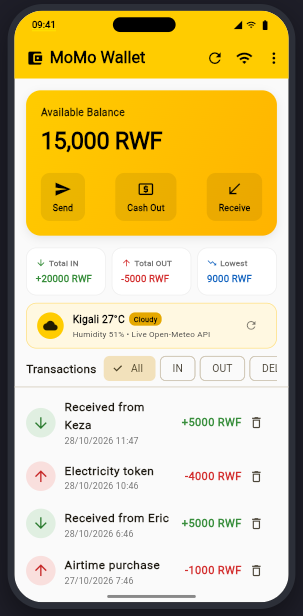
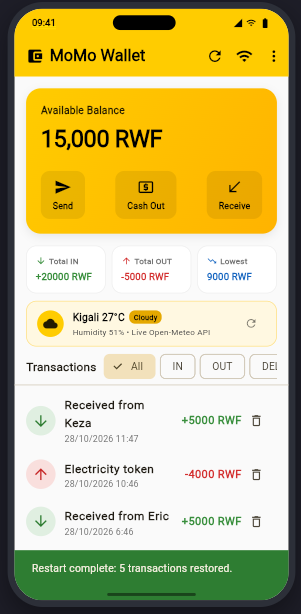
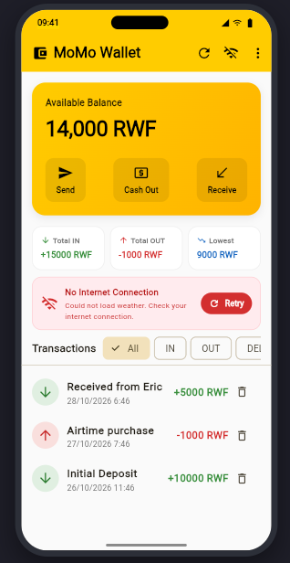

# MoMo Wallet

A mobile money wallet simulation app inspired by MTN Mobile Money in Rwanda. My data is now saved on the phone with `shared_preferences`, so nothing is lost when the app closes, and it shows live Kigali weather conditions and temperatures from the Open-Meteo REST API.

---

## Screenshots

| 1. Before Closing | 2. After Running Again | 3. Live Data from API | 4. No Internet / Retry |
| :---: | :---: | :---: | :---: |
|  |  |  |  |
| *App with new transactions added* | *State reloaded intact from `shared_preferences`* | *Live Kigali weather fetched from Open-Meteo* | *Network error state with Retry button* |

---

## Project Overview
Built upon logic from **Labs 2, 3, 6**, and **Session 5 (Persistence & Live API)** of the Mobile Programming course.

### Key Features
1. **Wallet Dashboard**:
   - Available balance card with quick actions: **Send**, **Cash Out**, and **Receive**.
   - Real-time statistics: **Total IN** (green), **Total OUT** (red), and **Lowest Balance Ever Reached**.
   - Transaction history sorted from newest to oldest.
2. **Transaction Filtering & Recycle Bin**:
   - Filter chips to view **All**, **IN** (incoming cash), **OUT** (outgoing transfers & cash-outs), and **DELETED** with real-time count `DELETED (n)`.
   - Dedicated deleted items view showing strikethrough styling and a one-tap **Restore** button (`Icons.restore`) to bring any removed transaction back into the active wallet.
   - Clean empty state handling displaying *"No transactions to display"* or *"No deleted transactions"*.
3. **Send Money Screen (Lab 2)**:
   - Dedicated transfer screen with balance check.
   - Strict phone number validation: exactly 10 digits and must start with MTN prefixes (`078` or `079`).
   - Minimum transfer amount of 100 RWF and insufficient balance validation.
   - Successful transfer records an OUT transaction: `Sent to 078XXXXXXX`.
4. **Agent Cash Out Screen (Lab 6)**:
   - Dedicated cash-out screen enforcing amounts in multiples of 100 RWF.
   - Real-time greedy Rwandan currency note breakdown (5,000, 2,000, 1,000, 500, and 100 RWF notes).
   - Shows the exact currency notes the agent dispenses before confirmation.
5. **Receive Money**:
   - Quick modal dialog to simulate incoming deposits and peer transfers with description and amount.
6. **Undo & History Integrity Protection (Lab 3)**:
   - Any transaction can be swiped to delete, moving it to the deleted pool with an instant **Undo** action via a `SnackBar`.
   - History safety check: prevents deleting an incoming transaction if doing so would cause the wallet balance to drop below 0 RWF at any point in historical records.
   - Deleted items remain accessible and restorable at any time under the **DELETED** filter.
7. **Local Data Persistence (Session 5 Part 2)**:
   - Persists all active transactions and deleted items using `SharedPreferences` with `toJson()` and `fromJson()` serialization.
   - Changes (sends, cash-outs, incoming receipts, deletions, and undos) survive app restarts.
   - Robust storage wrapper (`StorageService`) with pre-initialization, timeout protection, and in-memory fallback for web sandbox environments.
8. **Live API Integration (Session 5 Part 2)**:
   - Displays real-time Kigali weather in a prominent status card via the Open-Meteo REST API.
   - Handles the three essential asynchronous UI states:
     - **Loading**: Compact progress spinner and status text.
     - **Error**: Clear error message (*"Could not load weather. Check your internet connection."*) and a prominent **Retry** button.
     - **Data**: Real-time sky condition icon, temperature (e.g., *Kigali 24°C*), weather summary, and humidity.
   - Built-in offline simulation toggle in the AppBar for rapid testing and screenshot capturing.

---

## Think Answers

### 1. Why must every check happen before any money moves? What would go wrong if one check came after?
In financial applications, state modifications must be atomic and strictly protected against partial execution. If checks (such as recipient phone format, minimum transfer limits, or balance sufficiency) were executed *after* money was deducted or shifted in memory, an invalid input would leave the wallet in a corrupted state (for example, deducting funds for an invalid phone number or allowing the balance to fall into negative numbers). By performing all validations first and returning early, the application guarantees that state is only mutated when the transaction is 100% valid.

### 2. Your lowest-balance statistic needs a starting value. What did you start it at, and why not 0?
The lowest-balance metric records the minimum amount of money the user has ever possessed in their account history. Initializing it to 0 would cause an inaccurate result: if an account opened with 10,000 RWF and never dropped below 6,000 RWF, a starting value of 0 would falsely report 0 RWF as the lowest balance. Therefore, the starting value is set to the wallet's initial opening capital (10,000 RWF) or the initial deposit amount, and then recalculated by evaluating each transaction sequentially.
