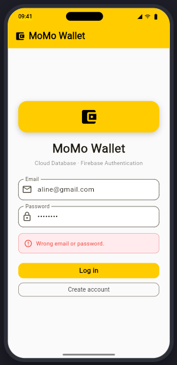
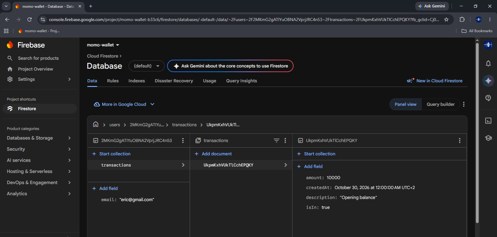
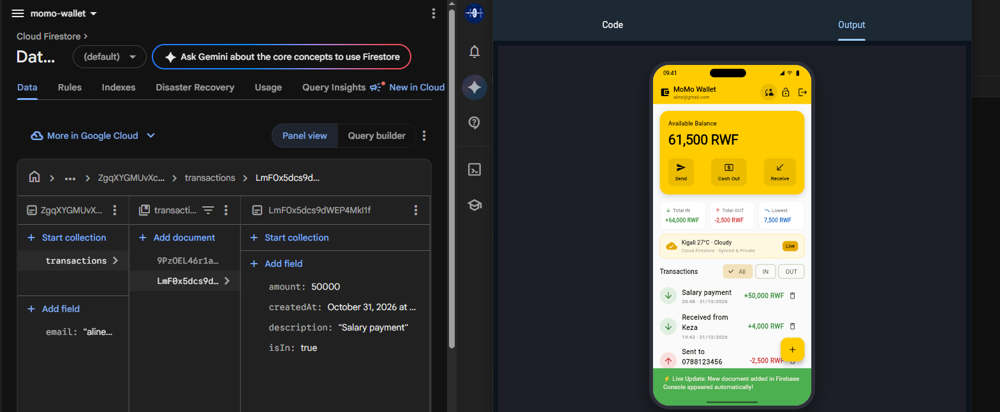
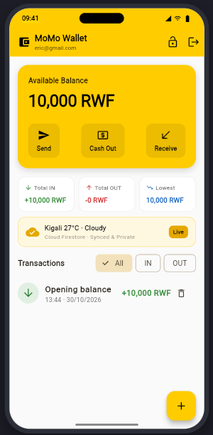

# MoMo Wallet

A mobile money wallet simulation app inspired by MTN Mobile Money in Rwanda. It signs users in with Firebase Authentication, and each user's data is saved in Cloud Firestore under their own id, so two accounts never see each other's data, and every change appears live.

## Screenshots

- Login: 
- My data in Firestore: 
- Live update: 
- Second account sees nothing of mine: 

---

## Architecture & Implementation Overview

### 1. Server-Side Security Rules (Habit 1: Never Trust the Client)
All user data lives under `users/{userId}/transactions`. The rules run on Google's servers and check every read and write:
```javascript
rules_version = '2';
service cloud.firestore {
  match /databases/{database}/documents {
    // Each user can only read and write their own data
    match /users/{userId}/{document=**} {
      allow read, write: if request.auth != null && request.auth.uid == userId;
    }
  }
}
```

### 2. Facts vs Computations (Habit 2: Save Facts. Compute the Rest.)
Only atomic events are persisted (`title`, `amount`, `isIn`, `createdAt`). The available balance, total money in, total money out, and lowest balance are never saved in the database; they are dynamically computed every time the data stream emits a new snapshot.

### 3. Reactive Streams
The interface is entirely reactive without manual `setState()` calls for remote data:
- `FirebaseAuth.instance.authStateChanges()` continuously delivers the user session to `AuthGate`.
- `myTransactions().snapshots()` pipes real-time Firestore database updates straight to the UI.
