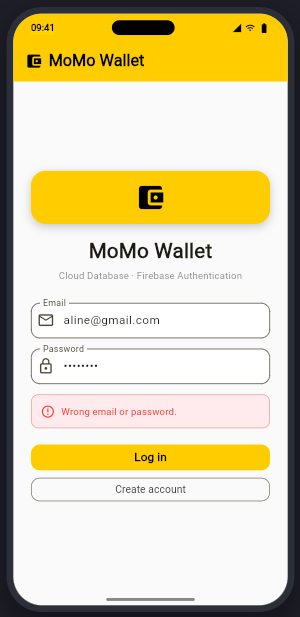
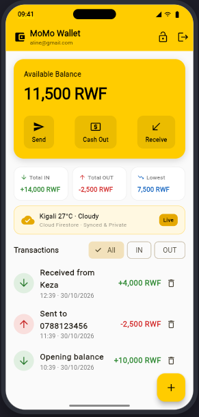
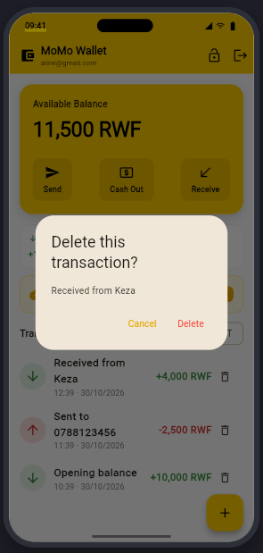
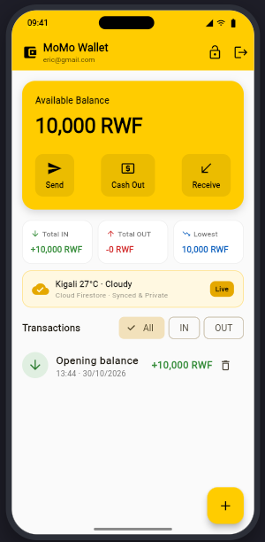
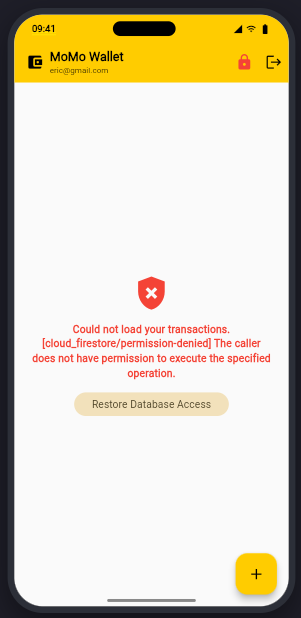

# MoMo Wallet (Session 6: Your App in the Cloud)

A production-grade mobile money wallet simulation app inspired by MTN Mobile Money in Rwanda. In Session 6, MoMo Wallet transitioned from local device storage to a **real cloud backend** powered by **Google Firebase**:
- **Firebase Authentication**: Secure user registration, credential validation, login, and session gatekeeping.
- **Cloud Firestore**: Real-time cloud database keeping user transactions synced across devices under `users/{userId}/transactions`.
- **Server-Side Security Rules**: Strict access control ensuring no client can read or tamper with another user's financial records.
- **Reactive Streams**: Real-time UI updates powered by Flutter's `StreamBuilder` and `StreamController` architecture.

---

## Visual Verification & Screenshots

| 1. Authentication & Errors | 2. Account 1 Dashboard & Gate | 3. Edit & Delete Confirmation |
| :---: | :---: | :---: |
|  |  |  |
| *Sign-in & account creation with validation* | *11,500 RWF computed balance, sample data & logout button* | *Dialog preventing accidental deletion from Firestore* |

| 4. User 2 Privacy Proof | 5. Security Rules Enforcement |
| :---: | :---: |
|  |  |
| *Account 2 (Eric) has its own isolated documents* | *Server rejection: `[cloud_firestore/permission-denied]`* |

---

## Architectural Highlights

### 1. Habit 1: Never Trust the Client (Server-Enforced Rules)
Client-side code runs on a phone that the developer cannot control. A rogue client could modify local Dart code or bypass the frontend entirely by making raw network requests. Therefore, Firestore security rules act as the server-side guard:

```javascript
rules_version = '2';
service cloud.firestore {
  match /databases/{database}/documents {
    // Each user can only read and write their own data
    match /users/{userId}/{document=**} {
      allow read, write: if request.auth != null && request.auth.uid == userId;
    }
  }
}
```

### 2. Habit 2: Save Facts. Compute the Rest.
MoMo Wallet strictly persists **atomic immutable transaction events** (`description`, `amount`, `isIn`, `createdAt`).
* **The Main Balance is NEVER saved directly**: Saving a computed balance creates a second copy of the truth. If a write fails midway, the stored balance diverges from transaction history.
* Instead, whenever the stream delivers the documents, the app sums them dynamically:
  $$\text{Balance} = \sum \text{Money In} - \sum \text{Money Out}$$
  If a transaction is deleted, the balance updates automatically and can never disagree with reality.

### 3. A Future is a Box. A Stream is a Pipe.
* **`Future` (Box filled once)**: Used for single asynchronous requests, such as authenticating credentials (`signInWithEmailAndPassword`) or writing a single document batch.
* **`Stream` (Continuous pipe)**: Used for live state monitoring. `FirebaseAuth.instance.authStateChanges()` continuously delivers the user session to `AuthGate`, while `myTransactions().snapshots()` pipes cloud database updates straight to the UI without requiring `setState()`.

### 4. Four Async Stream States
Every data screen strictly handles the four essential asynchronous states:
1. **Waiting / Loading**: Displays a clean `CircularProgressIndicator`.
2. **Error**: Displays human-friendly feedback and server diagnostics (e.g. `[cloud_firestore/permission-denied]`).
3. **Empty**: Displays an engaging illustration prompting the user to record their first transaction.
4. **Data**: Renders the live interactive financial dashboard.

---

## Project Structure

```
session4-pack/momo_wallet/
├── android/
│   ├── app/
│   │   ├── build.gradle.kts          # Applies com.google.gms.google-services & Flutter plugins
│   │   └── google-services.json      # Address card for package com.example.momo_wallet
│   └── settings.gradle.kts           # Google Services Gradle plugin definition
├── lib/
│   ├── auth_gate.dart                # StreamBuilder gatekeeper routing to Login or Wallet
│   ├── cash_out_screen.dart          # Cash out with currency note breakdown to Firestore
│   ├── login_screen.dart             # Firebase Auth email/password login and sign-up form
│   ├── main.dart                     # App initialization and Firebase.initializeApp()
│   ├── send_screen.dart              # Rwandan MTN phone transfer form writing to Firestore
│   ├── txn.dart                      # Txn model with toMap, fromDoc, and batch seed logic
│   ├── txn_form.dart                 # Add and edit transaction form with serverTimestamp()
│   └── wallet_screen.dart            # Live StreamBuilder dashboard with logout and CRUD
├── dartpad_momo_wallet.dart          # Unified, self-contained single-file runner with phone frame
├── pubspec.yaml                      # Configured with firebase_core, firebase_auth, cloud_firestore
└── README.md                         # Comprehensive project documentation
```

---

## Think & Conceptual Questions

### 1. Why must we never save the balance directly in the database?
Saving a total or balance creates a redundant "second copy of the truth". In distributed cloud architectures, network drops or partial write failures could update the transaction collection without updating the balance field (or vice versa), permanently corrupting financial integrity. By only storing the raw historical events (facts) and calculating the sum dynamically from the stream, the balance is guaranteed to be 100% accurate at all times.

### 2. Why is "Test Mode" dangerous in Firebase?
Test mode permits anyone with your project's URL or ID to read, overwrite, or delete every single document in your database without authentication. Furthermore, test rules expire automatically after 30 days, causing production crashes. Production applications must start with strict security rules enforcing authenticated user boundaries (`request.auth.uid == userId`).

### 3. What is the fundamental difference between a `Future` and a `Stream`?
A `Future` represents a one-off asynchronous operation that produces a single value (or error) and closes—analogous to a sealed package arriving in the mail once. A `Stream` represents an open sequence of asynchronous events emitted over time—analogous to a pipe delivering running water. In Flutter, authentication sessions and live database collections are best handled as streams because they emit new snapshots whenever the remote data changes.
